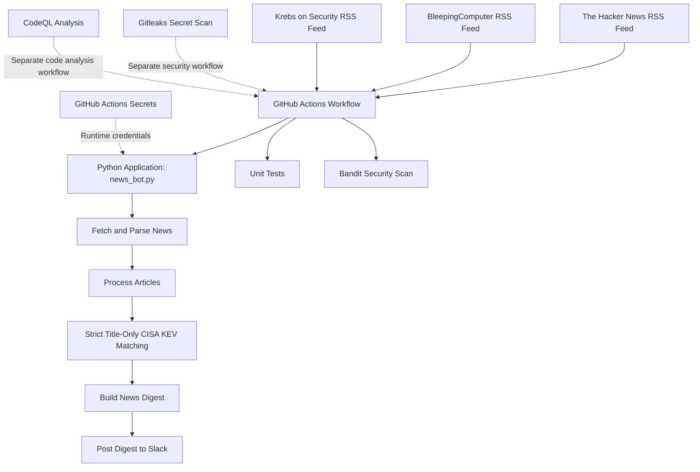

# Project Architecture

## 1. Project Overview

The Cybersecurity News Automation Bot is a Python application that collects cybersecurity news from configured sources and posts a digest to a Slack channel using GitHub Actions.

The project is designed to automate routine news collection while supporting automated testing and security checks.

### Main objectives

- Collect cybersecurity news from configured sources.
- Process news articles and prepare a digest.
- Match CVE identifiers in story titles against the configured CISA Known Exploited Vulnerabilities (KEV) catalog.
- Deliver the digest to a configured Slack channel.
- Run automated tests and security scans through GitHub Actions.
- Keep credentials outside the source code.

## 2. High-Level Architecture



**Note:** This is a conceptual diagram. The news-processing sequence illustrates the intended application flow; confirm the exact implementation against the current Python code and workflow files.

## 3. News Sources

The configured news sources are:

- [The Hacker News](https://thehackernews.com/)
- [BleepingComputer](https://www.bleepingcomputer.com/)
- [Krebs on Security](https://krebsonsecurity.com/)

The application retrieves articles from the feeds configured in the source code.

News feeds are external inputs. They may be unavailable, malformed, delayed, or changed by their publishers. External article content must not be treated as trusted instructions or executable code.

## 4. Application Components

### 4.1 Python Application

**Main file:** `news_bot.py`

The Python application is responsible for the news automation process and Slack delivery.

Its overall responsibilities include:

1. Reading the configured runtime credentials.
2. Retrieving and processing news from configured sources.
3. Applying the project's article-processing and KEV-matching rules.
4. Preparing the digest.
5. Attempting to deliver the digest to Slack.

The exact parsing, filtering, sorting, and duplicate-handling behavior depends on the current implementation.

### 4.2 CISA KEV Detection

The project uses a strict title-only CVE matching policy.

The intended logic is:

1. Extract CVE identifiers from a story's title.
2. Compare those identifiers against the configured KEV catalog.
3. Mark the story as a KEV match only when a title CVE is present in that catalog.

A CVE found only in a story summary must not trigger a KEV match.

This policy is intentionally strict. It may miss relevant vulnerabilities when a CVE identifier is absent from the title. A KEV match also does not establish whether a particular system or organization is affected.

For important vulnerability decisions, verify the information against authoritative sources, including the [official CISA KEV catalog](https://www.cisa.gov/known-exploited-vulnerabilities-catalog).

### 4.3 Slack Integration

The application posts its news digest to a configured Slack channel.

The GitHub Actions workflow passes credentials through repository secrets:

- `SLACK_BOT_TOKEN`
- `SLACK_CHANNEL_ID`

These values must not be hardcoded into Python files, documentation, tests, or workflow YAML.

Successful delivery depends on valid credentials, the Slack bot's permissions, network connectivity, and Slack service availability.

## 5. GitHub Actions

The main workflow is:

`.github/workflows/cybersecurity-news.yml`

It supports scheduled execution, manual execution, and pull-request validation.

### 5.1 Scheduled Execution

The configured schedule is:

```yaml
schedule:
  - cron: "30 3 * * *"
```

This represents 03:30 UTC daily, equivalent to 09:00 in Sri Lanka Standard Time (UTC+05:30).

GitHub Actions may delay scheduled workflow starts, so the digest is not guaranteed to arrive at the exact scheduled minute.

### 5.2 Manual Execution

The workflow supports `workflow_dispatch`, allowing an authorized repository user to start a run from the GitHub Actions interface.

A manual run can post to the configured Slack channel. Confirm that the intended branch and configuration are selected before running it.

### 5.3 Pull-Request Validation

The main workflow also runs for pull requests targeting `main`.

The Slack-posting step is skipped for pull-request events so that validation does not intentionally send production messages to the Slack channel.

Review workflow permissions and changes to workflow files before merging.

### 5.4 Quality Checks

The main workflow runs:

- Python unit tests
- Bandit security scanning

The tests and Bandit steps use `continue-on-error: true`, followed by a final step that fails the workflow if either check fails.

As a result, a Slack post may succeed even when a quality check fails. Always inspect the overall workflow result and the individual step outcomes.

## 6. Testing

The test directory is:

`tests/`

The test suite includes checks for the strict title-only KEV matching behavior.

Run the tests in an appropriate Python environment using:

```bash
python -m unittest discover -s tests -v
```

The tests help detect regressions but cannot prove that every application behavior is correct.

## 7. Security Controls

### 7.1 Bandit

Bandit checks Python code for selected security-related coding patterns.

Configured command:

```bash
python -m bandit -r news_bot.py -ll
```

Review findings rather than assuming that a clean scan proves the application is secure.

### 7.2 Gitleaks

The repository includes a Gitleaks workflow intended to identify patterns that may indicate exposed secrets.

A scan can produce false positives or miss some secrets. If a real credential is exposed, revoke or rotate it promptly.

### 7.3 CodeQL

The repository includes CodeQL analysis for supported code, subject to the current workflow configuration and successful execution.

Review any reported findings and address them where appropriate.

### 7.4 Repository Protection

The `main` branch should be protected with pull-request requirements and appropriate restrictions on force pushes.

Where practical, require relevant status checks before merging. Verify the active rules in the repository settings.

### 7.5 Least Privilege

GitHub Actions workflows should receive only the permissions they need.

Third-party actions should be reviewed and pinned to verified versions or full commit SHAs where practical. Changes that introduce new permissions or expose secrets require careful review.

## 8. Repository Structure

The main project files are expected to follow this general structure:

```text
cybersecurity-news-automation/
├── .github/
│   └── workflows/
│       ├── cybersecurity-news.yml
│       ├── gitleaks.yml
│       └── CodeQL workflow
├── docs/
│   ├── ARCHITECTURE.md
│   └── DEVELOPMENT-LOG.md
├── tests/
│   └── test_news_bot.py
├── news_bot.py
├── requirements.txt
├── README.md
├── CONTRIBUTING.md
└── SECURITY.md
```

This is a documentation reference structure. Confirm the actual filenames in GitHub before relying on every listed path.

## 9. Error Handling and Limitations

Potential failure points include:

- External feeds being unavailable or changing format.
- Network errors or timeouts.
- Missing or malformed article fields.
- Invalid Slack credentials or insufficient Slack permissions.
- Slack rate limits or service outages.
- Failed unit tests or security scans.
- Delayed scheduled workflow execution.

The application should handle external failures safely and avoid logging sensitive credentials.

A successful workflow step or Slack post does not guarantee that all articles are complete, accurate, or relevant.

## 10. Maintenance and Future Improvements

Potential improvements include:

- More comprehensive tests for malformed feed content.
- Better reporting of individual feed failures.
- Retry and timeout handling where appropriate.
- Additional tests for Slack API failures.
- Ongoing dependency and GitHub Actions maintenance.
- Clearer operational logging that excludes secrets.
- More detailed monitoring of workflow failures.

Document an improvement as implemented only after the corresponding code or configuration has been changed and verified.

## 11. Related Documentation

- `README.md` — project overview and setup instructions.
- `CONTRIBUTING.md` — contribution guidelines.
- `SECURITY.md` — vulnerability reporting and security practices.
- `docs/DEVELOPMENT-LOG.md` — development history and milestones.

## 12. Summary

The system combines Python-based news processing, GitHub Actions automation, Slack delivery, automated tests, and security scanning.

Its reliability depends on the implementation, external services, credential security, workflow configuration, and regular maintenance. Automated checks help reduce risk but do not guarantee that the application is free from bugs or security vulnerabilities.
