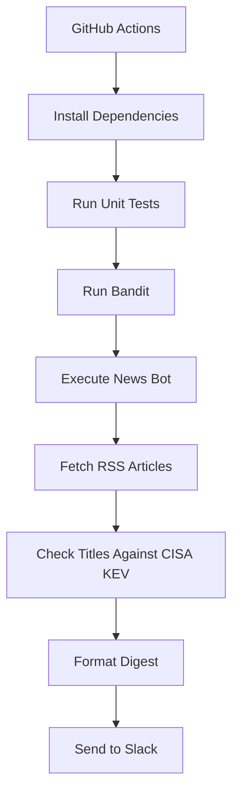

# Architecture

## Overview

The application collects cybersecurity news from configured RSS feeds, checks article titles against the CISA KEV catalog, and sends a digest to Slack.

## Workflow

## Components

- **GitHub Actions:** Scheduled and manual workflow execution.
- **RSS processing:** Collects articles from The Hacker News, BleepingComputer, and Krebs on Security.
- **KEV matching:** Identifies CVE references in article titles.
- **Slack integration:** Delivers the digest using configured credentials.
- **Testing and scanning:** Runs unit tests and Bandit analysis.

## Configuration

Slack credentials are supplied through the `SLACK_BOT_TOKEN` and `SLACK_CHANNEL_ID` environment variables, backed by GitHub Actions secrets.

## Limitations

KEV matching is title-based and does not establish whether a specific system is affected. In the current workflow, Slack posting may proceed even if tests or Bandit fail.
